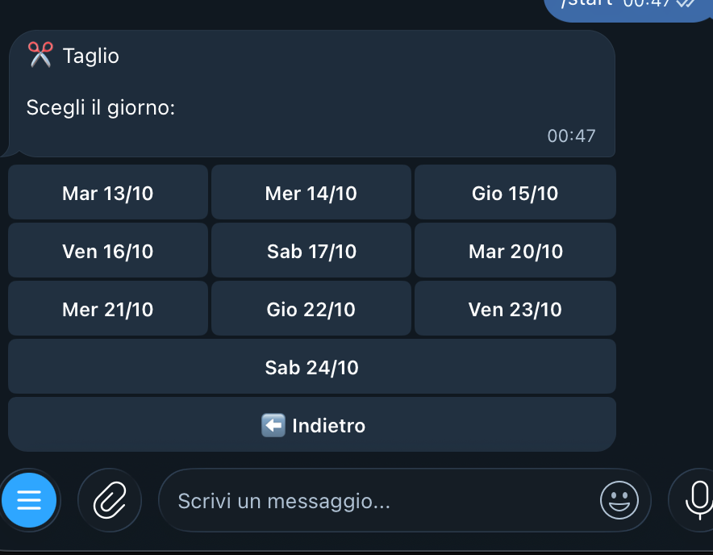
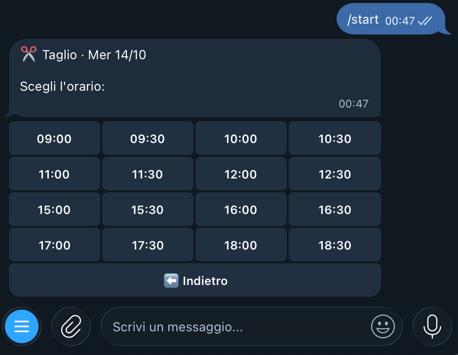
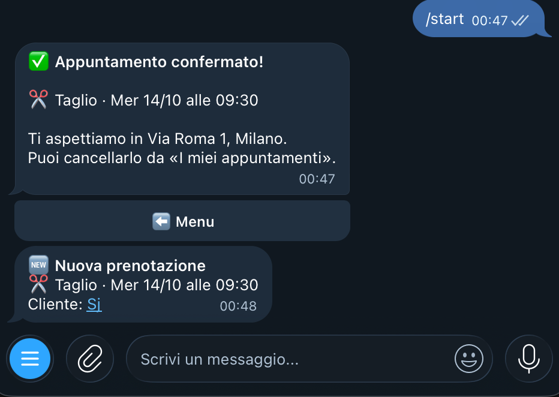

# 📅 Bot Telegram per prenotazioni

Bot Telegram che permette ai clienti di un'attività (barbiere, estetista, studio, palestra…) di **prenotare un appuntamento in pochi tocchi**, senza telefonate.

> 🇬🇧 **English:** Telegram booking bot for small businesses (barbers, beauty salons, studios). Customers book in a few taps, double bookings are impossible, and the owner gets instant notifications. Python · python-telegram-bot · SQLite.

## Screenshot

| Menu principale | Scelta del giorno |
|:---:|:---:|
|  |  |
| **Scelta dell'orario** | **Conferma e avviso al titolare** |
|  |  |

## Funzionalità

- **Prenotazione guidata a pulsanti**: servizio → giorno → orario → conferma
- **Solo orari davvero liberi**: niente doppie prenotazioni, giorni di chiusura e orari passati esclusi in automatico
- **I miei appuntamenti**: il cliente vede e cancella le proprie prenotazioni
- **Avvisi al titolare** a ogni nuova prenotazione o cancellazione, con link diretto al cliente
- **/oggi**: il titolare vede l'agenda del giorno
- Servizi, prezzi, orari e indirizzo **configurabili** in cima a `bot.py`

## Tecnologie

Python 3.9+ · [python-telegram-bot](https://python-telegram-bot.org/) · SQLite

## Installazione

```bash
git clone https://github.com/Araft95/bot-prenotazioni.git
cd bot-prenotazioni
python3 -m venv venv
./venv/bin/pip install -r requirements.txt
cp .env.example .env   # poi inserisci il token di @BotFather
./venv/bin/python bot.py
```

## Comandi

| Comando  | Chi      | Cosa fa                                  |
|----------|----------|------------------------------------------|
| `/start` | tutti    | Apre il menu                             |
| `/mioid` | tutti    | Mostra il proprio ID Telegram            |
| `/oggi`  | titolare | Elenco degli appuntamenti di oggi        |

## Personalizzazione

Tutto si configura in cima a `bot.py`: nome dell'attività, indirizzo, servizi e prezzi,
orari di apertura (anche con pausa pranzo), durata degli appuntamenti e quanti giorni in anticipo si può prenotare.

## Licenza

MIT
